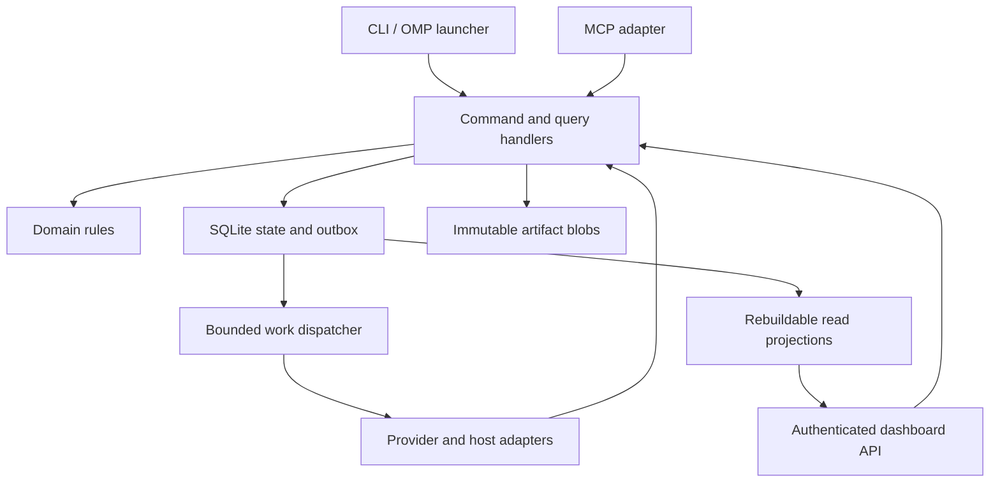

# PRISM Studio architecture

Status: proposed implementation contract for UI Design Studio 2.0.0. Pack version: 1.0.0. No application implementation is included in this document. All `src/`, `.omp/`, `docs/design/`, `.prism/` and `.prism-state/` paths below are **target repository paths**, not paths within this pack. Other relative links refer to this pack.

## 1. Decision and constraints

Build a modular Python application with one authoritative domain engine, a local SQLite database, immutable content-addressed blobs, and thin CLI, MCP and authenticated HTTP adapters. Preserve current public package/CLI/skill aliases during transition. Introduce no broker, distributed database or frontend framework as a prerequisite.

The product coordinates decisions, work and evidence. Its difficult consistency problems are small: recording a valid decision once, reserving remaining design spend once, selecting a specific artifact version, and recovering after an interrupted operation. Those operations belong in short transactions. Rendering, artifact discovery, provider calls and view refreshes occur outside those transactions.

The rebuilt product must preserve the baseline's capability authentication, root/path confinement, immutable preview evidence, owned-process cleanup, installation rollback and one shared engine. Fix the confirmed contradictions and cost/revision gaps without discarding these controls. The source baseline is commit `60307ef31fd6e2bad1d39620fc507b0b822e281a`, UI Design Studio 1.4.3.

Related contracts: [domain contracts](DOMAIN-CONTRACTS.md), [design governance](DESIGN-GOVERNANCE.md), [migration and compatibility](MIGRATION-AND-COMPATIBILITY.md), [JSON Schema](../contracts/domain.schema.json), [command catalog](../contracts/command-catalog.json). Requirement families CORE, APPROVAL, REVISION, BUDGET, WORKER, SECURITY and MIGRATION govern this design; the authoritative IDs live in [requirements](../contracts/requirements.json).

## 2. Runtime topology and module ownership

This diagram describes responsibilities, not separately deployed services. Initially the dispatcher, projection worker and HTTP server may share one process with bounded executors. CLI or MCP processes can connect to the same local store using transactions; they do not mutate JSON files independently.

Proposed target package organization:

| Module | Responsibility | Excluded responsibility |
|---|---|---|
| `src/ui_design_studio/domain/` | Typed records, invariants, transition functions, dependency and readiness evaluation | HTTP, MCP, provider SDKs, filesystem traversal |
| `src/ui_design_studio/application/` | Shared handlers, authority checks, transaction orchestration, idempotency and receipts | Duplicated rules in adapters |
| `src/ui_design_studio/storage/` | SQLite repositories/migrations, blob staging, snapshots, outbox and export | Deciding whether an approval is sufficient |
| `src/ui_design_studio/adapters/` | CLI, MCP, HTTP, provider and host integrations | Independent approval/budget interpretation |
| `src/ui_design_studio/projections/` | Dashboard/status views, indexes, cursor pagination | Authorizing implementation or spend from cached data |
| `.omp/skills/ui-design-studio/` | Discovery metadata, project-owned instructions and thin launchers | A second copy of the Python engine |

The installer records the Python environment that owns the canonical package. OMP wrappers call that environment or a documented equivalent packaged launcher. A source archive must contain the same canonical code and installation instructions. Wheel, ZIP and OMP behavior are tested as separate delivered entry points against the same contracts.

Pure functions over immutable records are acceptable. Do not add a class hierarchy, plugin abstraction or process boundary unless it has a concrete consumer and reduces a demonstrated problem.

## 3. Source tree, private state and portable artifacts

Use separate identifiers for project identity, source location and state location. Git presence is optional. A run resumes by `projectId` plus an explicit workspace binding; an unrelated Git commit or a historical remediation filename is not a root-discovery contract.

| Location | Meaning and ownership |
|---|---|
| `<repo>/.prism/project.json` | Optional portable, non-secret project defaults and stable project ID. Existing project instructions remain authoritative within their scope. |
| `<repo>/.prism-rebuild/` | This handoff pack when installed by the pack helper. It is not runtime state. |
| `<repo>/.prism-state/` | Uncommitted handoff/verification receipts and exported evidence summaries used by pack tools. It may contain a locator to runtime state, not the authoritative database. |
| `<local-state>/prism-studio/projects/<projectId>/studio.sqlite3` | Authoritative local, single-host runtime database. Default local-state follows the host platform's user-state location; the installer records the resolved path. |
| `<local-state>/prism-studio/profiles/<profileId>/settings.sqlite3` | Private personal defaults and host/dashboard settings, owned by the same Python core. Separate epoch/idempotency namespace; excluded from project exports. |
| `<state-root>/blobs/sha256/<first-two-hex>/<sha256>` | Immutable artifact bytes. Database metadata supplies MIME type, dimensions and provenance. |
| `<state-root>/staging/<operationId>/` | Private incomplete blob/import work. Never served as Ready evidence. |
| `<state-root>/backups/` | Verified database/manifest backups and migration receipts. |
| `<repo>/docs/design/runs/<legacy-run-id>/` | Legacy dossiers; read during copy-first import. Keep untouched until an explicit later archival action. |

Store no credentials, raw capability tokens or personal model preferences in committed project files, exports, logs or prompts. Personal defaults reside in the private local profile database; a run stores the resolved policy and its origin, without secrets. A preference command changes one database realm. Run creation reads the selected personal/project snapshots and persists its resolved settings in the project transaction; it does not claim cross-database atomicity. A later defaults edit does not change that run. Portable `.prism/project.json` defaults are explicit import/export inputs, not a second writable authority. A portable export uses logical IDs and relative blob paths. Import binds them to a chosen source repository; an absolute path from another machine grants no authority.

SQLite WAL is permitted only on documented local single-host storage. It is not a network-filesystem solution. Detect known network mounts and reject an unsupported state path before creating mutable state; report an unverified storage arrangement explicitly instead of claiming it was tested. The source repository may be elsewhere, including a mounted path, while state remains local. Two machines must not open the same database. Multi-host synchronization is outside 2.0.0.

## 4. Transaction and persistence model

Enable foreign keys for every connection. Use a supported SQLite runtime, a documented journal/durability configuration, bounded busy timeout and short write transactions. The portable initial policy is `journal_mode=DELETE`, `synchronous=FULL`, with serialized writes; qualified local deployments may explicitly select WAL with FULL. Both policies must pass the same concurrency, crash and restore gates on their supported host builds. Record the chosen mode; never silently switch it. Selecting SQLite does not promise WAL. Never hold a transaction while generating images, waiting for a provider, scanning a repository or awaiting user input.

Record the actual linked `sqlite3.sqlite_version` and `sqlite_source_id()`; Python version alone does not establish database suitability. Multi-connection WAL requires a runtime containing the documented WAL-reset fix: SQLite3.51.3 or later, the recognized3.44.6/3.50.7 backports, or attributable vendor patch evidence. If that qualification is absent, use the explicitly supported/tested DELETE policy or report WAL unavailable; do not force an unsanctioned system upgrade or stall unrelated work. This prerequisite follows [SQLite's WAL-reset advisory](https://www.sqlite.org/wal.html#walreset), verified for this pack; it is not an instruction to install dependencies during pack preparation. Read back actual pragma values rather than assuming an issued setting took effect.

Logical tables include `projects`, `workspace_bindings`, `model_preferences`, `versioned_snapshots`, `runs`, `components`, `artifact_versions`, `dependencies`, `approval_requests`, `approval_decisions`, `approval_revocations`, `review_batches`, `revision_requests`, `annotation_sets`, `budget_accounts`, `budget_reservations`, `cost_entries`, `provider_attempts`, `worker_tasks`, `worker_leases`, `instruction_snapshots`, `gate_assessments`, `evidence`, `blob_staging`, `operations`, `events`, `outbox`, `projection_cursors`, `imports`, `theme_installations` and `migration_receipts`. Use foreign keys and unique indexes for identities, operation keys and attempt/lease ownership. The schema file describes interchange records; it is not a prescribed one-table-per-record ORM design.

Mutable domain records have integer revisions starting at 1. A conditional update includes the previous revision in its `WHERE` clause and increments exactly once; a zero-row update is a conflict. Immutable versions, decisions and ledger entries are appended, not edited. Projections may be replaced because they are reconstructible.

### Authoritative command protocol

1. Resolve the authenticated principal and host/session authority. Parse bounded input with the shared schema. Never trust a client-supplied actor merely because it parses.
2. Scope the idempotency key to owning project/profile realm, authenticated principal and command. Look up a completed receipt before evaluating stale revisions: an identical retry returns its original receipt. The same key with a different canonical request is `IDEMPOTENCY_CONFLICT`.
3. Read the required authoritative inputs and prepare the bounded transition and canonical request/entity snapshot blobs. Verify/install/flush those immutable blobs before publishing their references. Begin a short write transaction and claim the operation key under a unique index; if another operation owns it, return its status or a bounded retry instruction.
4. Recheck all prepared input revisions, capability grants, dependency manifests and domain invariants using authoritative rows. If preparation became stale, return the appropriate conflict or redo bounded preparation; never commit its old assumptions. Aborted preparations may leave unreferenced blobs for later cleanup.
5. Apply the transition, persist its events/outbox rows and receipt together, then commit. An expected validation conflict may be stored as a stable rejected receipt. Transient database unavailability is not recorded as a successful domain outcome.
6. Return a receipt containing committed revisions and accepted per-item results. Notify/update projections after commit. Outbox redelivery is safe because consumers track event IDs/cursors.

Pre-authentication errors do not create a receipt that reveals whether protected IDs exist. Store no secret token in an operation fingerprint or retained request. A lost HTTP response after commit must be recoverable by operation ID/idempotency key. Each event references the exact canonical typed entity snapshot; each operation retains its secret-free request blob for auditable reasons and intent. Replaying these facts rebuilds derived views; authoritative recovery uses validated state snapshots/exports and integrity checks rather than assuming the notification log is a complete event-sourcing implementation. Replay never reissues provider calls, publishes a theme or performs filesystem installation.

### Blob commit protocol

Filesystem bytes and a SQLite transaction are not automatically atomic. `blob.prepare` allocates principal/scope-bound private staging with a declared digest and size bound. Authenticated streaming transport writes only that object; `blob.verify` validates MIME/format, exact length and SHA-256. Flush the complete file and atomically install it under its digest on the same local filesystem before publishing artifact metadata. If that digest exists, verify the existing immutable blob before reusing it. Only then commit Ready metadata and dependency references through `artifact.register`. Flush directory entries where required by the supported platform's durability contract. The same publish-after-durability rule applies to retained operation/event snapshots and imported blobs.

A crash before metadata commit can leave an unreferenced blob; it must not create a Ready artifact. A crash after metadata commit must leave a complete retrievable blob. Recovery verifies missing/corrupt referenced blobs and blocks dependent actions with an explicit reason. Do not silently regenerate an approved artifact under its old identity. Images and rich HTML previews retain the existing sanitization/content isolation controls; a matching hash is not proof that executable content is safe.

## 5. Approval, revision and readiness boundaries

An approval decision is historical; applicability is computed for a requested action and exact scope. Requests bind stable component IDs, exact immutable artifact versions, relevant requirement/policy/instruction versions, and dependency versions. Display progress, watcher timestamps and an unrelated Git commit are excluded from the approval fingerprint.

A dependency edge means **dependent artifact/version uses prerequisite version**. When a new prerequisite is selected, only dependent scopes requiring that new version are stale. Independent accepted siblings retain their decisions. Composition is its own artifact/version and check scope, so changing one child rechecks the composition without demanding fresh approval for every unchanged child.

Use stage values `assess`, `plan`, `design`, `produce`, `finalize`; display labels may be friendlier. Run lifecycle is separate. Readiness is evaluated by `(runId, stage, scope, dependency fingerprint, criteria version)`, never by the latest decision keyed only to stage. Assessment-only, design-only, focused revision and full runs use different required gate sets. A design-only run can complete its agreed handoff without claiming implementation or deployment passed.

See [governance](DESIGN-GOVERNANCE.md) for guided/YOLO decisions, batch semantics and annotation bindings, and [domain contracts](DOMAIN-CONTRACTS.md) for the exact applicability algorithm.

## 6. Design cost and external execution

Each run has an explicit-currency design budget account. Amounts are safe JSON integers in declared minor units; unknown is `null` with an explicit status. Implementation and pack-building costs are tracked separately when available and excluded from the design cap by default. Critique enters the design category only according to the recorded run policy. No currency or historical price table is silently assumed.

For admission, atomically enforce `settled design debits - recognized design credits + active design reservations + requested reservation <= design cap`. Credits must be observed, attributable adjustments; optimistic refunds do not create capacity. Require a controlled dispatch route and a supported upper charge bound before labeling enforcement Hard. Otherwise label it Advisory and make the limitation available in the API and UI.

Persist an attempt before an external request. Use a provider idempotency facility only when it is actually advertised and its scope/retention are known. An expired lease, timeout, disconnect or cancellation request does not prove that remote work stopped or cost zero. Keep the reservation and set outcome/billing uncertainty explicitly until a provider receipt or authorized reconciliation resolves it. A retry that could cause an additional charge is a new admitted attempt, not silent replay.

If the provider can charge beyond the reserved bound, the route cannot honestly promise a hard cap. If an observed result nevertheless exceeds its asserted bound, record the real charge, stop new design dispatch and surface the breach; never falsify the ledger to preserve the invariant's appearance. Price quotes carry source, timestamp, model identity, unit basis and validity; execution records actual observed assignments.

## 7. Worker ownership, instructions and capacity

Worker permissions are the intersection of host/session permissions, inherited project/path instructions, run policy and the task's explicit grant. YOLO changes design-decision authority only. It does not grant network access, secret access, arbitrary writes, publication or messages to others.

A worker packet includes project/run/task IDs, exact input versions, objective and output contract, permitted operations/write paths, dependency waits, budget reservation/attempt identity, and the actual readable instruction snapshots applicable to those paths. Include full relevant `AGENTS.md` content or a resolvable immutable reference plus its hash; a generated summary cannot replace it. Record source and precedence. Do not hardcode a remediation document or infer permission from the availability of a tool.

Owned paths are anchored to a named repository/output root. They can authorize new files under an allowed directory; existence is not a prerequisite. Validate normalization, the nearest existing parent and symlink resolution before access; repeat checks at write time. A task cannot broaden its own grant by editing instructions. Changing instructions requires a separate authorized command and re-evaluation of affected work.

Use a durable ready queue, priorities and explicit dependency reasons. Resolve concurrency from run/project/personal settings plus observed host/provider capacity and admitted budget. There is no hardcoded three-worker rule. If a provider's concurrency is unknown, serialize that route until a configured or observed capacity policy supplies a bound; report this as a fallback, not measured capacity. Model selection precedence is invocation override, persisted run settings on resume, project defaults, personal defaults, then capability/cost-based auto selection. Preserve current-model mode.

Leases have attempt IDs and monotonically increasing fencing tokens. A late worker result is accepted only if its token still owns the task; otherwise retain the result as orphaned evidence and do not overwrite current state. Lease expiry triggers investigation/reconciliation before repeating paid work. Cancellation first blocks new admission, then requests remote/local cancellation, then resolves outcome and cost separately.

## 8. Dashboard and capability handshake

Expose authenticated metadata before the client offers workflow actions: package version, contract/schema versions, instance ID, capability revision, supported commands/features, payload/annotation/page limits, actual SQLite runtime/journal policy and patch evidence, storage assurance, observed provider/host abilities and read-only reasons. Metadata describes observed capability; it does not promise that optional services are installed. Revalidate changed capabilities at dispatch.

Clients refuse incompatible contract majors, explain missing required features and may provide a read-only history view when safe. `run.get` returns the typed `RunView` with bounded component/history pages, current budget/gates and freshness. The server supplies `allowedActions` and per-action structured `disabledReasons` for the current scope. These are discoverability hints; every command is authorized again. Focused approval, batch, gate, budget, artifact and operation queries avoid unrelated expensive work. The same handler powers dashboard, MCP and CLI errors and outcomes.

Maintain small projection rows for lists, decisions, progress and artifact metadata. Fetch image bytes lazily and reuse thumbnails keyed by immutable digest and transform parameters. Use filesystem notifications as hints, coalesce bursts and perform bounded reconciliation scans for externally changed source files. Cache file digests conservatively; recompute authoritative evidence when a relevant dependency changed. Do not reread all blobs for every snapshot.

Notification transport may begin with conditional/delta polling or long polling; SSE is optional. Use a durable event cursor containing database epoch and sequence. A reconnect with a cursor gap receives a fresh authoritative snapshot, not guessed missing events. The approval receipt supplies the accepted result immediately, so projection lag cannot visually undo the click. Expose connection freshness, pending operations and recovery without treating acknowledgement as job completion.

Loopback startup must not require LAN enumeration. LAN access is explicit, retains authentication and origin/host validation, and reports address-discovery failure without breaking local use. Retain owned-server identity and cleanup checks; never kill a process based on a port or PID alone.

## 9. Recovery, retention and operational evidence

Recovery classifies incomplete operations by durable state: uncommitted local work, committed result with undelivered notification, dispatched external work with unknown outcome, and incomplete artifact/import staging. Each has a distinct recovery action. A startup transaction may repair bookkeeping or replay outbox delivery; it must not automatically repeat chargeable external effects.

Retain all blobs referenced by recorded decisions, pending revisions, active checkpoints, theme restore points, exports being prepared and unresolved provider work. Garbage collection starts with a dry-run reachability plan under a state revision. Recheck references at deletion time. Never apply a generic last-N-versions rule to evidence. Unreferenced temporary/cache data can have a documented age policy; historical evidence removal is a separate explicit archival/deletion operation. A database backup without its referenced blobs is not a complete recovery backup.

Measure queue wait by cause, provider duration, unresolved attempt/reservation age, outbox lag, projection freshness, snapshot work/bytes, artifact integrity failures and command latency. Do not log prompt contents, auth tokens or unrestricted file paths unnecessarily. Diagnostics distinguish unknown, unavailable, deferred, failed and passed.

Meaningful failure tests include concurrent reservation of the same remaining allowance, crash between commit and response, orphaned staging, stale worker completion, reconnect after cursor expiry, independent component approval retention and restore of a migrated run. These are application tests; successful verification of this pack does not establish them.

## 10. Why these principles, and what is deliberately excluded

This is original synthesis, not a reproduction of the supplied resources. Vaughn Vernon's *Domain-Driven Design Distilled* (2016), PDF pp.41–47,71–83,89–99, supports explicit language, small consistency boundaries and atomic state/event persistence. It does not require this application to split repositories or adopt an object hierarchy. Ben Stopford's *Designing Event-Driven Systems* (2018), PDF pp.53,120–124,134,157–163, informs version checks, reservations and external-effect uncertainty; the book itself acknowledges a simpler single-process option. Jonas Bonér et al.'s *The Reactive Principles*, v1.0, PDF pp.10,13,15–19, informs responsive degraded behavior and bounded flow. Alex Xu's *System Design Interview*, second edition, PDF pp.51–69,229–235,251–260, informs admission, DAGs and immutable versions; its large-scale topology and historical benchmark figures are not project requirements.

Current implementation references: [SQLite isolation](https://www.sqlite.org/isolation.html), [SQLite WAL](https://www.sqlite.org/wal.html), and [Apache Kafka's explicit boundary on external exactly-once effects](https://kafka.apache.org/42/design/design/). Kafka is cited for the limitation, not selected as a dependency. Domain events, a local outbox and read projections do not require full event sourcing. A hash proves byte identity, not user intent, correctness, authority or accessibility.
