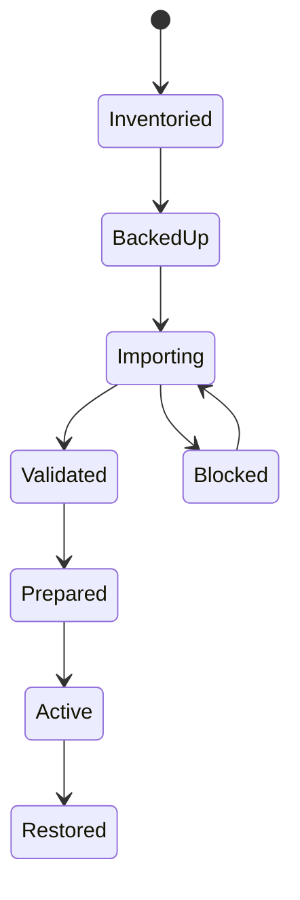

# Migration, compatibility and recovery

Status: implementation specification, not an executed application migration. Applies to UI Design Studio 1.4.3 at baseline commit `60307ef31fd6e2bad1d39620fc507b0b822e281a` and the proposed2.0.0 runtime. Requirement owners: REQ-CORE-007 and REQ-MIGRATION-001 through005. All source/runtime paths below are **target repository or host paths**; document links are pack-relative.

## 1. Compatibility promises

Preserve the existing `ui-design-studio` Python package identity, `ui-design` CLI and documented `tools/ui-design` project wrapper, MCP entry points, OMP discovery names and `ui-design-studio` skill alias through the2.0 transition. PRISM Studio is the working product name, not permission to break discovery paths. Add new canonical operations behind adapters; keep legacy aliases as explicit translations with capability metadata and machine-readable deprecation information. Removal requires a later declared compatibility policy and tested consumer migration, not a silent rename.

Canonical engine code lives in the Python package. Existing OMP script locations may remain as thin launchers to the installed environment recorded in the installation receipt. They must not carry a fork of domain behavior. Existing positional/programmatic interfaces used by shipped wrappers receive a tested compatibility facade where needed; internal implementation details need not remain permanent public APIs.

| Legacy surface | Proposed handling |
|---|---|
| Run/status/resume CLI and MCP operations | Resolve an explicit legacy locator to its imported run ID; return the shared query/receipt model with an adapter-compatible presentation. |
| Stage-wide `approval-request` or decision command | Translate only when its target is uniquely resolvable. If multiple component requests are possible, return an actionable ambiguity/conflict; never choose an unseen newest artifact. |
| Browser approval body with `rationale` | Translate to `feedback`; omitted/null/blank Approved feedback normalizes to empty. Preserve original request/digest checks via the scoped manifest. |
| `auto-models` / `current-model` | Map to `auto` / `current`; retain requested/resolved/observed distinction and source evidence. |
| Existing theme registry/import/build/select/restore | Import identities and exact artifact/provenance where supported; maintain reversible selection and installation receipts. Unknown legacy theme state is explicit, not a new empty default. |
| Source ZIP, wheel, project/OMP install | Exercise installation-to-review-to-decision-to-resume using the delivered package. Packaging must include all required runtime contracts and wrappers. |

An alias cannot represent a new behavior by guessing. Unsupported combinations return a documented error and a suggested canonical operation. Compatibility cannot bypass host permissions, capability authentication, path confinement, expected revisions or monetary admission.

## 2. Version and capability negotiation

The metadata operation reports product/package version, contract version, supported persisted schemas, instance/database epoch, capability revision, feature names, supported operations, limits and read-only reasons. Persisted data version is independent of a package patch release. Every adapter checks required contract major and features before offering actions.

An older client may read compatible projected fields and ignore additive response fields. Unknown command fields are rejected, preventing typo-driven behavior. An unknown persisted major version is not opened for writing; a future version may be inspected/exported as opaque evidence if the safe importer supports that operation. Never down-convert by dropping fields that establish authorization, cost or evidence identity.

On reconnect, distinguish a process restart from a new database epoch. A stale event cursor gets a fresh snapshot. Cached action availability is rechecked at command execution. Changing model/provider/tool capability during a run invalidates only work requiring that changed capability and may require rerouting within existing policy; it does not retroactively alter observed assignments.

## 3. Legacy inventory and mapping

Baseline legacy inputs include `run.json` versions1.0/1.1, `coverage.json` versions1.0/1.1, `decisions.json` version1.0, `manifest.json` resume data, `approval-requests/`, immutable artwork/publication metadata, approval attachments/annotations, worker/progress files, project/model-routing dossiers and theme registry/package records. Model-routing records include1.1/1.2 variants. Normal dossiers are under `docs/design/runs/<run-id>/`, but an explicit configured root is respected.

Import only formats for which a versioned adapter exists. Inventory all files, canonical relative paths, sizes/digests and source-format versions before mapping. Unknown files are preserved as original evidence when safe, not executed or interpreted as instructions. The inventory identifies missing blobs, unsafe paths/symlinks, unresolved dependencies, malformed records and unverifiable provenance.

| Legacy fact | New mapping and uncertainty policy |
|---|---|
| Run ID, mode and scope | Stable legacy-to-new ID map; preserve explicit Guided/YOLO and map known scope types. Unknown fields remain findings requiring repair, not inferred defaults. |
| `phase`, `status` | Lifecycle/display state only. They cannot prove stage readiness or completed work. |
| `projectContext` summary | Preserve as an artifact; separately capture actual currently applicable project/path instructions. A summary is not a substitute for `AGENTS.md`. |
| Decision actor `user` / `agent-yolo` / `director` | Preserve asserted original actor/provenance. Only verifiable evidence supports active authority; `director` finalization is not a human design decision. |
| Approved with empty rationale | Preserve; emptiness is not itself a reason to reject a human approval under the new contract. Other authority/version evidence still must be verified. |
| `changes`, request-changes option, rejected outcome | Normalize only when intent is unambiguous; preserve raw original values. Do not accidentally convert requested changes into authorization. |
| Pending/superseded entries | Map to request/history lifecycle, not an invented approved decision. |
| `inputs` / `inputsDigest` | Recompute using the original algorithm against the preserved source snapshot before translating. Retain original digest and exact available inputs; never synthesize missing historical bytes. |
| Whole-run / decision-file digest | Retain as provenance. Build the new meaningful dependency manifest explicitly; removing an old broad digest does not automatically establish a valid new approval. |
| Stage-wide approvals | A compound legacy scope can retain the exact known input set. Do not invent per-component approvals that the source never recorded. |
| Payload/dependency byte budget | Preserve as resource limits, never money. Legacy absence of currency/spend means unknown/unconfigured, not zero/unlimited. |
| Model routing prose/assignments | Preserve requested and recorded data. Mark observed assignment unknown unless actual execution evidence establishes it. |
| Coverage/check labels | Preserve original declarations; distinguish verified evidence from structural completeness. No automatic conversion of a label into an observed pass. |
| Annotation coordinates | Import as editable active geometry only if the exact image, dimensions and coordinate transformation are demonstrable. Otherwise retain a legacy attachment and require deliberate rebasing. |
| Resume environment/dirty state | Keep as historical diagnostics. Fresh readiness depends on declared relevant inputs; writing a new checkpoint or an unrelated commit must not make the checkpoint immediately stale. |

Default imported decisions are historical/unverified until the adapter can demonstrate their complete scope, bytes and applicable authority from retained evidence. A narrow confirmation can adopt exact imported artifacts into a new verified request/decision; the migrator cannot impersonate that confirmation. Missing original timestamps remain null in provenance; import time is labeled import time. Never manufacture an actor, approval, price, currency, model identity or evidence result to make validation green.

## 4. Copy-first migration state machine

Use a durable migration ID and candidate state root. Legacy data stays intact. The source checkout is never reset, stashed or cleaned by migration. A dirty repository is not by itself a blocker; source mutation during the inventory/import is a concrete conflict.

1. **Inventory:** resolve explicit source and local destination roots; verify access/path bounds and source versions; calculate an inventory digest. Identify live legacy writers without killing them. Preparation can run against a stable snapshot; activation requires writers quiesced and the source digest unchanged.
2. **Back up:** create a byte-preserving source backup plus manifest and checksums outside the source tree; verify restoration into a temporary location. A2.x database backup uses SQLite's backup API or another documented consistent snapshot procedure, not a raw copy of an open `.sqlite3` file detached from its WAL.
3. **Import:** create a separate candidate database and immutable blobs. Derive stable new IDs from a recorded migration namespace plus source relative path/logical record identity; append indices disambiguate distinct historical records. Keep the mapping durable. Commit bounded chunks and checkpoint source position, digests, counts and findings.
4. **Validate:** run schema, foreign-key, graph, currency, identity/provenance and blob-integrity checks; compare counts and digest inventory. Rebuild projections and evaluate readiness without sending provider calls or creating approvals. Report known gaps separately from migration corruption.
5. **Prepare activation:** finish outstanding local writes, verify the source inventory again, record prior binding/epoch and candidate epoch/watermark in a durable activation journal. Confirm runtime/storage prerequisites and that no conflicting process can write the old or candidate store.
6. **Activate:** atomically replace the small project state locator with the candidate binding, flush/read it back, and finalize the activation receipt. The locator and SQLite databases are not one transaction; the journal makes the intermediate state recoverable. Startup uses the verified locator plus journal to finish or roll back the binding change, never guesses which store is current.
7. **Retain:** keep original source, backup, ID map and activation receipt. No automatic deletion follows successful activation. Offer portable export and a documented restore path.

`MigrationReceipt.phase` records `inventoried`, `backed_up`, `importing`, `validated`, `prepared`, `active`, `blocked` or `restored`, with source/candidate/backup digests, counts, checkpoint and findings. The receipt does not claim application acceptance merely because the conversion completed.

### Repeatability and interruption

Same migration ID + unchanged inventory resumes from the last verified chunk and reuses IDs/blobs/receipt identities. Unique import keys prevent duplicate decisions or ledger entries. If source bytes change, stop with `IMPORT_CONFLICT` and preserve both snapshots; a new source snapshot requires a new migration identity or explicit re-inventory. Never continue a cursor over mixed source generations.

| Failure point | Recovery contract |
|---|---|
| Before complete backup | Leave source active; discard/restart only owned incomplete backup staging. |
| During blob import | Reverify staged bytes; reuse verified digest blobs; do not register incomplete artifacts. |
| During database chunk | SQLite rolls back that chunk; resume from its previous committed checkpoint. |
| After validation, before locator change | Candidate remains inactive and inspectable; original remains current. |
| After locator rename, before final receipt | Read the activation journal and verify pointed candidate epoch; finish receipt or restore prior binding. Do not rerun import blindly. |
| After new runtime writes | Preserve those writes. A rollback cannot overwrite or silently abandon them. Export/fork or use a reviewed reverse migration. |

## 5. Rollback and later schema upgrades

A restore command names the migration receipt and expected active database epoch/watermark. If no later writes exist, it can restore the prior verified binding and record the operation. If later writes exist, return a divergence conflict and provide a safe fork/export plan. The user may choose an explicit forked restore that preserves the newer store; there is no force-overwrite default.

Future2.x schema upgrades also use a backup, migration identity, forward version check, deterministic transformations and verification before activation. Where SQLite supports a fully atomic in-place DDL/data change, it can be used after backup, but do not mix it with uncontrolled filesystem mutations. Irreversible transformations require a new copy and explicit compatibility policy. Downgrading a binary is not equivalent to migrating data backward.

Preserve namespaced original raw records as evidence when mapping is incomplete. Quarantine a malformed record with its digest/reason rather than letting one bad record block unrelated read-only inspection or silently discarding it. Mutations depending on that record remain blocked.

## 6. Portable export/import format

An export contains a root manifest, typed records as bounded JSON/JSONL sets and immutable blobs under relative content-addressed paths. The `ExportManifest` records export ID, project/run IDs, schema version, database epoch/event watermark, exported record counts, every file's path/length/SHA-256 and unresolved findings. Obtain metadata from a consistent database snapshot and pin the referenced blob set until export completes. Include referenced approval/revision/theme evidence even if old; do not apply latest-only pruning.

Exclude raw capability tokens, provider secrets, local executable paths, personal defaults, live locks/leases and uncontrolled absolute workspace bindings. Export task history and unknown provider liability as data; import must not dispatch it automatically. Rebind workspace paths and reauthorize actors/capabilities on the destination. Historical decisions remain provenance; their applicability is reevaluated against exact imported inputs and target policy.

Personal model/worker defaults use the private local profile database and its own revision/epoch; migrate them only through an explicit local profile import/update under that principal's authority. Project defaults remain project-owned `ModelPreferenceSet` snapshots. Neither import rewrites the resolved policy of an existing run. Unknown accountless currency stays a null currency/exponent pair; a design account must establish an explicit pair before monetary admission. Import theme history with its actual scope (`dashboard`, `generated_product`, `omp_host`) and target provenance; an ambiguous legacy host target remains unresolved rather than becoming permission to install or activate.

Validate before extraction/activation: no absolute paths, drive/UNC paths, parent traversal, NULs, duplicate/case-colliding entries, links/devices, oversized entries or decompression beyond declared bounds. Normalize portable separators and reject ambiguous names. Treat all manifests and documents as data, never commands. Verify every listed digest, reject missing required blobs, and quarantine unsupported formats. The importer cannot grant authority from a capability record contained in the archive.

## 7. Runtime and storage prerequisites

Record Python version **and** the actual linked SQLite version/source ID, journal mode, synchronous setting, foreign-key state, destination filesystem assurance and backup verification result. Read back pragma settings. Python>=3.10 alone says nothing about whether its bundled SQLite contains required fixes.

For multi-connection WAL, require the WAL-reset fix documented by SQLite:3.51.3+ or an identified fixed backport3.44.6/3.50.7, or attributable vendor patch evidence. An unqualified runtime can use the explicitly supported DELETE rollback journal with FULL and serialized writes after the same concurrency/crash/restore gates; the initial portable policy selects that mode. Report the choice in metadata and the migration receipt; no silent downgrade or forced system upgrade is permitted. Do not use WAL on a network filesystem or across hosts. These are installation/runtime gates, not instructions to install software during handoff preparation.

Backup tests must prove that referenced blobs and database state restore together. Preserve SQLite's own recovery files; deleting `-wal`/`-shm` to make a lock problem disappear is not an approved recovery procedure. Owned-process and database-lock diagnostics precede any cleanup. Loopback dashboard startup must work even if LAN enumeration is forbidden by the environment.

## 8. Verification and release conditions

Exercise: empty-feedback approval through every adapter; unrelated progress versus relevant artifact invalidation; non-Git project resume; instruction inheritance and new-file ownership; copy-first import interruption; duplicate import; malformed/missing historical evidence; foreign currency/unknown legacy cost; activation-journal crash; rollback with later writes; source ZIP parity; and theme selection/restore.

Each compatibility fixture declares source schema, original bytes/digest, expected normalized record and remaining uncertainty. Application migration tests operate on isolated copies. Keep pack-integrity PASS, application tests, installed host verification and human evaluation as separate claims. The shared [acceptance cases](../contracts/acceptance-cases.json) and [milestones](../contracts/milestones.json) own completion evidence.

## Source basis

Original synthesis from Stopford, *Designing Event-Driven Systems* (2018), PDF pp.138–144 on schema evolution and unreadable data; Vernon, *Domain-Driven Design Distilled* (2016), PDF pp.96–99 on causal persistence/history; and Xu, *System Design Interview*, second edition, PDF pp.251–261 on versions and recovery. None is an authority for deleting evidence or converting ambiguous legacy records into approvals.

Primary implementation references: [SQLite WAL and backup implications](https://www.sqlite.org/wal.html), [WAL-reset fix details](https://www.sqlite.org/wal.html#walreset), [SQLite online backup API](https://www.sqlite.org/backup.html), and [SQLite isolation](https://www.sqlite.org/isolation.html). Exact runtime behavior must be checked on the supported host builds.
