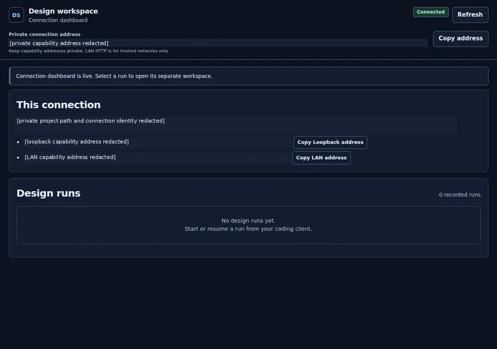
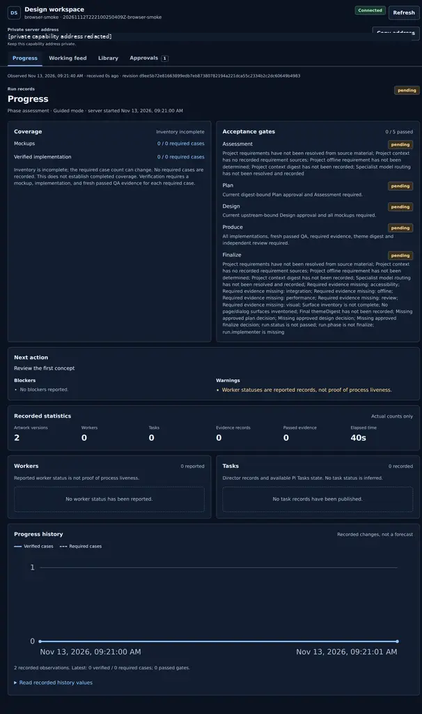
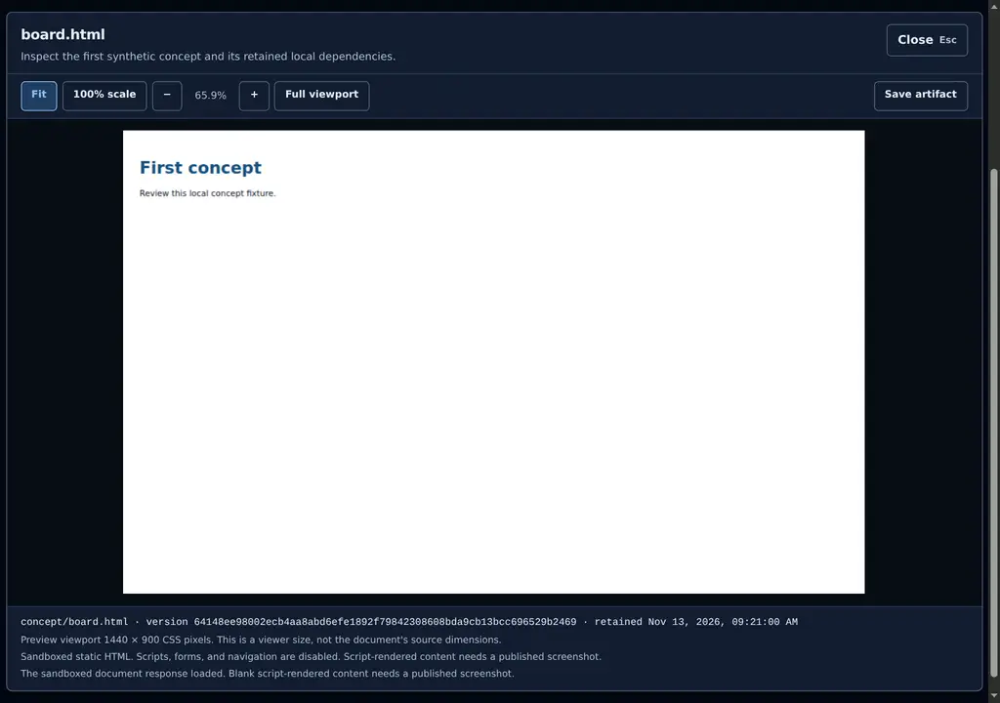

# UI Design Studio v1.3.0

## Changes

Local MCP clients can now use UI Design Studio without installing OMP files into the target project. The new `ui-design-studio-mcp` wheel bundles the engine, nine skill guides, seven role briefs, dashboard assets, schemas, and specimen theme.

- Each stdio connection opens its own authenticated dashboard before any run exists. Initialization creates no design dossier.
- Typed tools, workflow prompts, and allowlisted resources expose the existing design workflow. Human approval remains a digest-bound browser action, not an MCP tool.
- Verified loopback and LAN addresses, locally generated terminal QR codes, and `ui-design dashboard-info` make the active workspace discoverable.
- Run-server reuse checks instance identity. Disconnect closes owned listeners without deleting dossiers or stopping another connection's borrowed server.
- OMP gains `/ui-design-dashboard [SESSION_ID]` and waiting-connection details in its existing progress widget. Explicit run ownership and Pi Tasks boundaries remain intact.
- The OMP installer remains standard-library-only. MCP dependencies and client configuration stay separate.
- MCP initialization advertises the Studio package version instead of the SDK's default version.

## Examples

### Install the downloaded wheel

Require Python 3.10 or later. Run these commands from the directory containing the downloaded release wheel.

```bash
python3 -m venv .venv-ui-design-mcp
.venv-ui-design-mcp/bin/python -m pip install ./ui_design_studio_mcp-1.3.0-py3-none-any.whl
```

These paths use the Unix virtual-environment layout. Native Windows execution has not been verified.

### Connect a local MCP client

Use this server entry in your client's own configuration format. Replace both absolute paths. It is not a universal top-level configuration object.

```json
{
  "command": "/absolute/path/to/.venv-ui-design-mcp/bin/ui-design-mcp",
  "args": ["--repo", "/absolute/path/to/project", "--dashboard-host", "127.0.0.1"]
}
```

This example uses loopback only. The default bind address is `0.0.0.0` for trusted-LAN access. HTTP exposes bearer credentials and project content to network observers. Do not use an untrusted network.

After initialization, read `ui-design://dashboard` or call `ui_design_dashboard_info`. Call `ui_design_start_run` with `{"theme_id":"first-concept"}` to create a pending run. Missing context, routing, approvals, or verification remains a blocker.

### Print verified addresses and a terminal QR code

While the MCP connection is running, use a second terminal.

```bash
.venv-ui-design-mcp/bin/ui-design dashboard-info --repo /absolute/path/to/project
```

With several connections, add `--session INSTANCE_ID`. The command probes identity before printing `[ok]`, complete URLs, and the locally generated QR code. Keep capability addresses private. No address is sent to an external QR service.

### Keep the existing OMP workflow

From the extracted source distribution, install into the target project.

```bash
bash ./install.sh --project /absolute/path/to/project --dry-run
bash ./install.sh --project /absolute/path/to/project
```

In OMP, use `/ui-design-dashboard` to select a live MCP connection, or `/ui-design-progress RUN` for an explicitly selected run. The adapter does not add `/goal`, model-routing configuration, or OMP event protocols to other clients.

## Screenshots

These are actual Chromium captures from a synthetic verification project. Private capabilities, project paths, and connection identity are visibly redacted. The simple artwork fixture tests retained HTML and local dependencies. It is not a finished theme or a production application.

### Waiting connection

The authenticated connection dashboard exists before any run is created.



### Pending run and evidence gates

The synthetic run reports zero passed gates. The dashboard does not turn missing evidence into success.



### Retained artwork preview

The existing sandboxed viewer loads retained HTML with its local stylesheet and image dependency. Scripts, forms, and navigation remain disabled.



## Verification and limits

The implementation passed 195 Python tests and 33 Node tests. Actual Linux checks exercised SDK stdio, clean installed-wheel operation outside the checkout, Chromium interactions, an OMP PTY, real loopback and LAN aliases, approval persistence, cleanup, and independently decoded terminal QR output. See [Release validation](VALIDATION.md) for scope and reproduction commands.

Native Windows/macOS, other native MCP clients, and a second physical device were not exercised. Only local stdio MCP is supported. This release does not certify a recipient application's accessibility, compatibility, or production readiness.

## Downloads

- `UI-Design-Studio-OMP-v1.3.0.zip` contains the complete source distribution and OMP installer.
- `ui_design_studio_mcp-1.3.0-py3-none-any.whl` is the standalone MCP package. Runtime dependencies install through pip.
- Matching `.sha256` files verify the exact downloads.
- The screenshot PNGs and these notes are also attached to the GitHub release.

Existing v1.2.0 release assets and its tag remain unchanged. See [Installation](INSTALLATION.md) for project-local update and restore safeguards, or [MCP setup](MCP.md) for adapter details.
