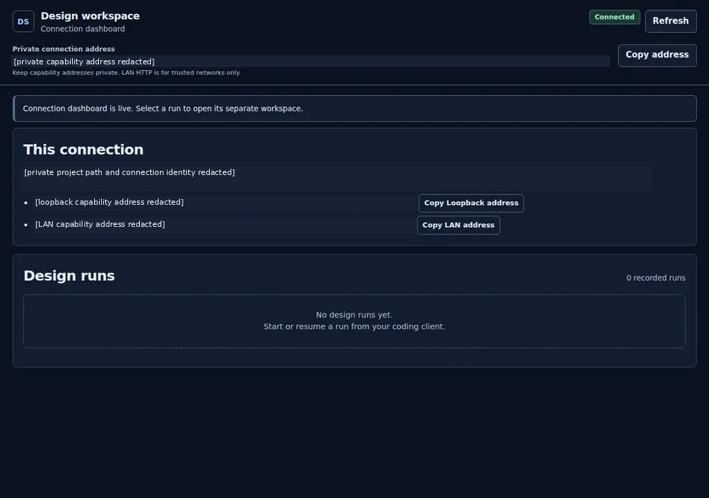
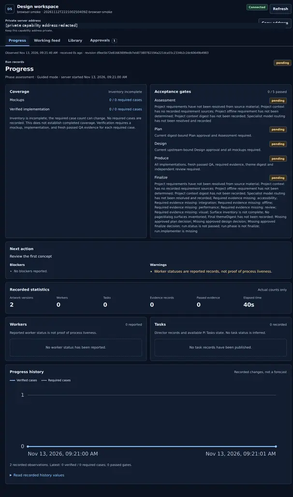
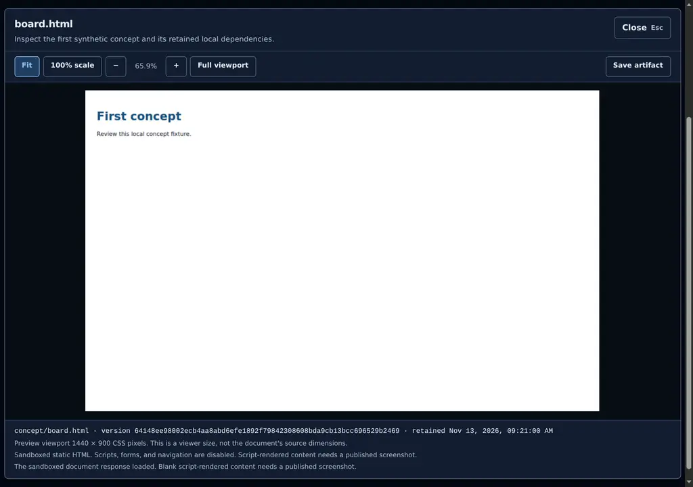

# UI Design Studio v1.4.0

Released 13 November 2026 UTC.

## Changes

Install the optional MCP runtime once for all projects. OMP now starts and supervises its own authenticated dashboard before any design run exists. The dashboard stays available during work and approval pauses, recovers unexpected child exits, and stops with its owning session. It is not an OS service.

- `install.sh --mcp-global` installs an isolated user environment without sudo, system pip changes, or client configuration edits.
- `ui-design dashboard-serve` provides foreground operation with verified local and LAN URLs and a locally generated terminal QR code.
- `/ui-design-dashboard stop` inhibits automatic restart. `/ui-design-dashboard start` explicitly restarts the dashboard.
- Existing local stdio MCP, project-local OMP installation, evidence gates, and explicit run-director ownership remain supported.

## Set up the global runtime and OMP

Require Python 3.10 or later with `venv`, Bash, and dependency-download access. From the extracted `ui-design-studio-v1.4.0` directory, run:

```bash
bash ./install.sh --mcp-global
bash ./install.sh --project /absolute/path/to/project --dry-run
bash ./install.sh --project /absolute/path/to/project
```

The global environment lives at `~/.local/share/ui-design-studio/mcp`. Its executables are exposed in `~/.local/bin`. Add that directory to your shell's `PATH` for the foreground examples. OMP also checks the fixed environment path.

The global option installs only the runtime. Install the OMP extension in each target project separately. Every project retains separate records and permissions.

For an existing OMP installation, finish a checkpoint and restore temporary worker routing before updating. Use the new distribution:

```bash
bash ./install.sh --mcp-global
bash ./install.sh --project /absolute/path/to/project --update --dry-run
bash ./install.sh --project /absolute/path/to/project --update
```

The updater preserves user configuration, checks ownership and conflicts, and prints a backup ID. Keep that ID and the source distribution. In the project's OMP session, submit:

```text
/reload-plugins
```

A main OMP session starts the dashboard automatically without creating a design run. Use these commands individually:

```text
/ui-design-dashboard
/ui-design-dashboard stop
/ui-design-dashboard start
```

The first command prints verified URLs and the QR again. OMP output names its stop command. Ctrl-C in OMP is not promised to stop only the dashboard.

## Start a foreground dashboard

```bash
ui-design dashboard-serve --repo /absolute/path/to/project
```

Keep that terminal open. The foreground banner says `(Ctrl-C to stop)`. Ctrl-C closes owned listeners. Add `--dashboard-host 127.0.0.1` for loopback-only operation.

While the dashboard is live, print its verified connection details from another terminal:

```bash
ui-design dashboard-info --repo /absolute/path/to/project
```

With several live connections, add `--session INSTANCE_ID`. Keep complete `#token=` fragments private. The QR contains the displayed LAN capability URL, or loopback when LAN is unavailable. No URL is sent to an external QR service.

## Use the standalone wheel

The wheel remains available for local MCP stdio clients without project-local OMP installation:

```bash
python3 -m venv .venv-ui-design-mcp
.venv-ui-design-mcp/bin/python -m pip install ./ui_design_studio_mcp-1.4.0-py3-none-any.whl
```

Use this server entry in your client's own configuration format. Replace both absolute paths:

```json
{
  "command": "/absolute/path/to/.venv-ui-design-mcp/bin/ui-design-mcp",
  "args": ["--repo", "/absolute/path/to/project", "--dashboard-host", "127.0.0.1"]
}
```

This is not a universal top-level client configuration object. See [MCP setup](MCP.md) for typed tools, workflow prompts, guides, and connection ownership.

## Security fixes and network limits

Global installation ignores inherited pip destination configuration. An external pip target cannot redirect the install over an unrelated user executable. Ownership and symlink checks protect existing environments and exposed executable paths.

Dashboard discovery verifies authenticated instance identity before displaying live URLs. Recovery preserves the selected run. A cancelled OMP session switch does not prematurely tear down the current dashboard.

The default dashboard bind address is `0.0.0.0` for trusted-LAN access. HTTP exposes bearer credentials and project content to network observers. Use only trusted networks or select loopback-only operation. There is no remote HTTP MCP service, tunnel, firewall edit, or public-internet security claim.

## Recover an interrupted session or update

Unexpected OMP dashboard exits trigger bounded recovery. After three rapid failures, automatic recovery stops and reports `/ui-design-dashboard start`. Resolve the reported error, then use that command. An intentional stop remains stopped until you request start.

If automatic startup cannot find a runtime, rerun `bash ./install.sh --mcp-global` from this distribution. Install or update the project's OMP extension, then reload plugins. Do not delete private records or ownership state to bypass a conflict.

Project installation restore uses the exact printed backup ID:

```bash
bash ./install.sh --project /absolute/path/to/project --restore BACKUP_ID --dry-run
bash ./install.sh --project /absolute/path/to/project --restore BACKUP_ID
```

Restore checks for later edits. It reverses project package installation changes, not application changes or the separate global runtime upgrade. Reinstall a retained source release to change the global runtime version. Dossiers and recorded evidence remain intact when owned listeners stop. Resume existing work rather than creating an overlapping run.

## Verification and platform limits

The completed feature passed 140 automated cases on Linux, comprising 91 Python tests and 49 Node tests. Python coverage comprised 61 MCP/dashboard/package cases, 11 global-installer cases, 15 project-installer cases, and four installed-extension cases. Node coverage exercised awaited startup, single-flight ownership, bounded recovery, explicit stop, run selection, cancelled switches, and Pi Tasks boundaries.

Actual Linux checks used Python 3.12.3, Node 24.22.2, and OMP 18.20.0. One global installation and repeated upgrades served two projects with spaces in their paths. Real SDK and installed CLI consumers exercised authenticated landing pages, guide access, pending create/resume, discovery, EOF cleanup, and dossier preservation. Actual OMP PTY checks exercised startup before a run, child recovery, explicit stop/restart, and owned shutdown. Two complete rendered OMP QR cards decoded independently to their displayed LAN capability URLs.

After the version update, the final wheel passed four installed-package tests. Version-sensitive protocol and installer suites also passed, for 44 rerun cases in total. These overlap the completed-feature cases rather than adding 44 unique cases.

See [Release validation](VALIDATION.md) for the recorded scope and reproduction commands. These are synthetic package checks, not verification of a recipient application's design or production readiness.

Native Windows, native macOS, another native MCP client, and a second physical LAN device were not verified. Unix virtual-environment paths in these examples are not native PowerShell instructions. The dashboard lasts only while its foreground process or owning OMP session remains alive. Machine shutdown ends that lifetime.

## Illustrative v1.3.0 screenshots

These existing redacted Chromium captures are from v1.3.0 synthetic verification. They illustrate the retained dashboard and artwork views, not new v1.4.0 global installation or automatic-startup captures.







## Downloads

- `UI-Design-Studio-OMP-v1.4.0.zip` contains the source distribution and OMP installer.
- `ui_design_studio_mcp-1.4.0-py3-none-any.whl` contains the standalone MCP runtime and bundled guides/assets.
- Matching `.sha256` sidecars verify the exact downloads. Checksums are not publisher signatures.

Existing tags, releases, and historical distribution assets remain unchanged. See [Installation](INSTALLATION.md) for update safeguards and [Distribution](DISTRIBUTION.md) for package reproduction.
