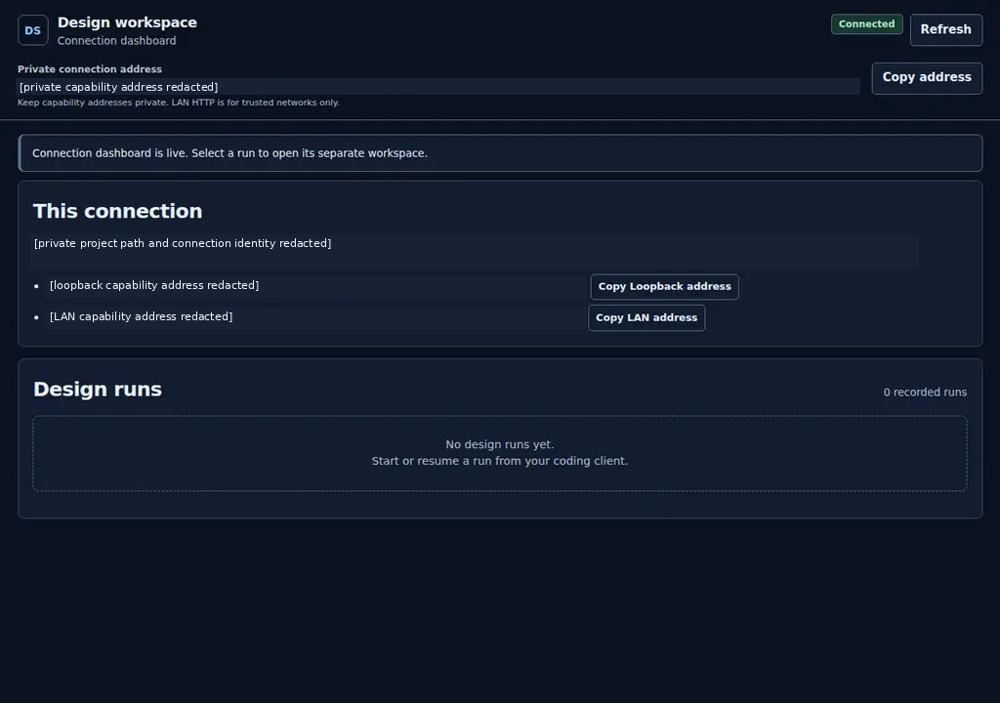
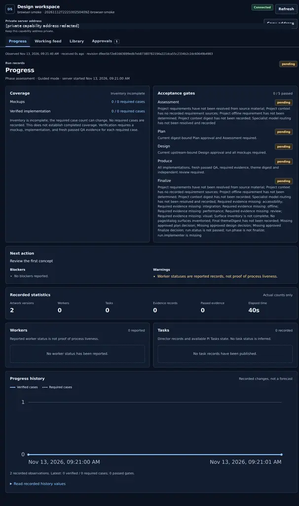
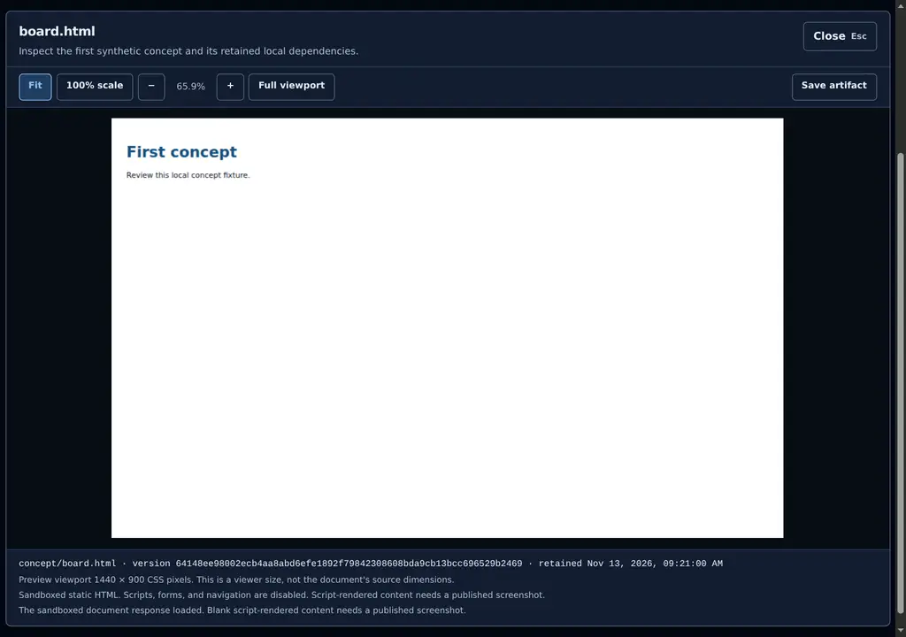

# UI Design Studio v1.4.1

Released 14 November 2026 UTC.

## Changes

This patch release ships the Cortex remediation work from v1.4.0.

- Binds evidence validation to declared inputs and approval digests.
- Normalizes model-field variants before conflict checks.
- Bounds compact and paged status output for large dossiers.
- Adds dependency-aware resume manifests and selected-role worker packets.
- Adds applicability-aware coverage checks and host-feasibility guidance.
- Adds deterministic offline remediation benchmarks and compatibility records.
- Adds regression coverage for package, installer, MCP, dashboard, and Studio paths.

## Verification

See the [release validation record](VALIDATION.md) for recorded automated checks and their limits. The [remediation test report](remediation/v1.4.0/TEST-REPORT.md) preserves the earlier remediation results. Human and recipient-application testing remain outside this package release.

The package remains a project-independent workflow. A recipient project still needs its own design run, host integration, accessibility checks, performance checks, and deployment review.

## Screenshots

These existing redacted Chromium captures are from v1.3.0 synthetic verification. They illustrate retained dashboard and artwork states, not new v1.4.1 captures or recipient-application evidence.

## Downloads

- `UI-Design-Studio-OMP-v1.4.1.zip` contains the source distribution and OMP installer.
- `ui_design_studio_mcp-1.4.1-py3-none-any.whl` contains the standalone MCP runtime and bundled guides and assets.
- Matching `.sha256` sidecars verify exact downloads. Checksums are not publisher signatures.

Native Windows, native macOS, other native MCP clients, and a second physical LAN device remain unverified. The dashboard exposes bearer credentials on trusted LAN HTTP; use loopback or protected transport on untrusted networks.
