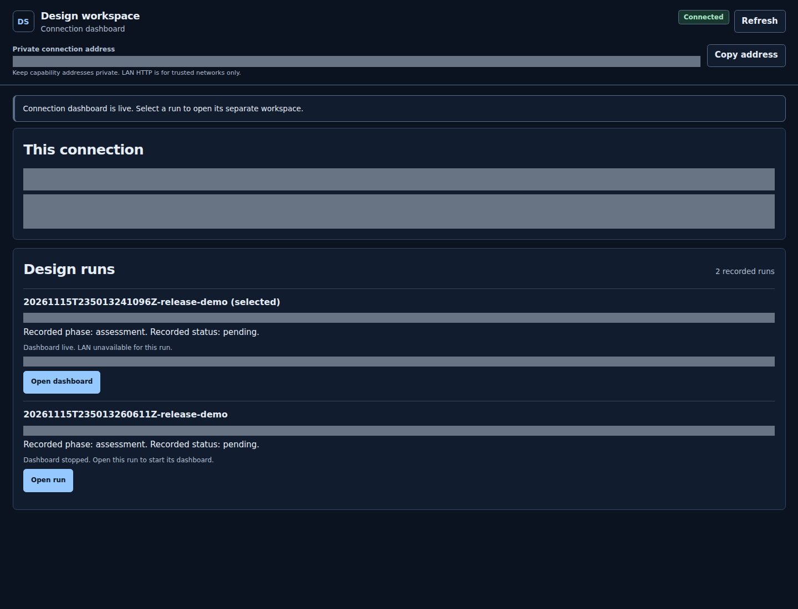
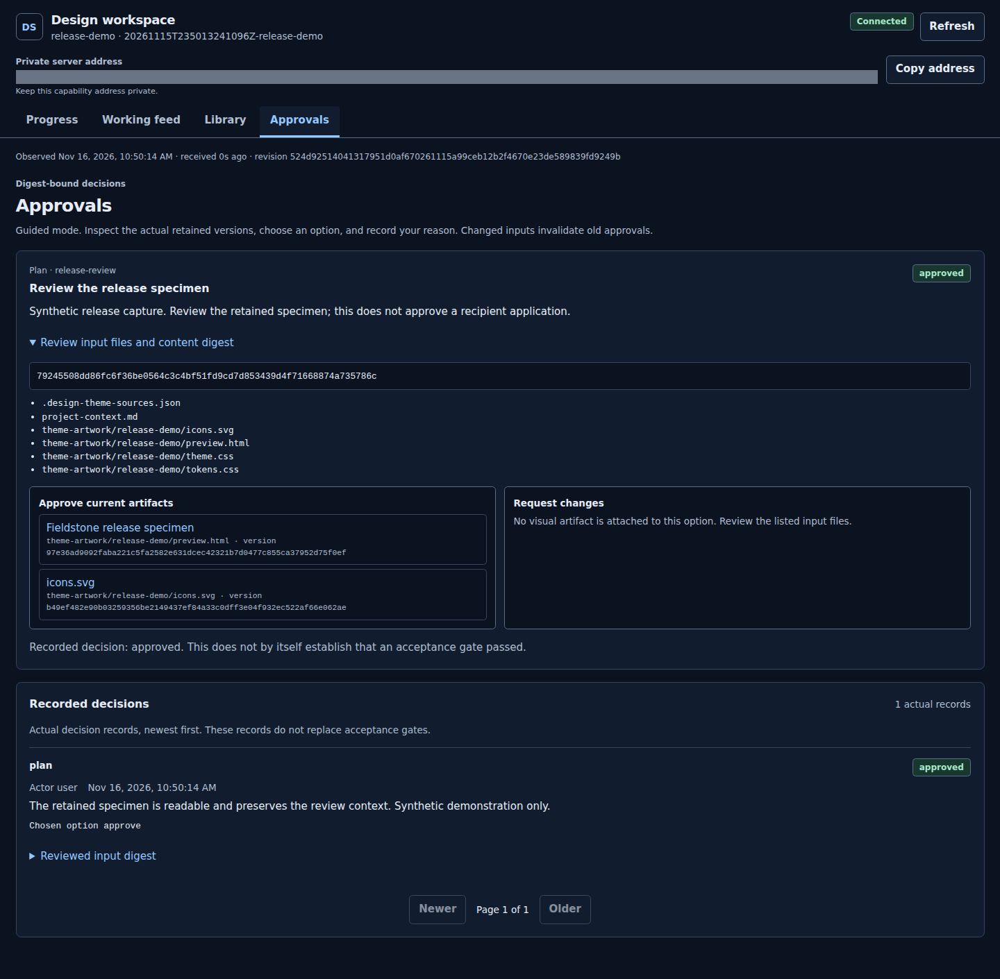
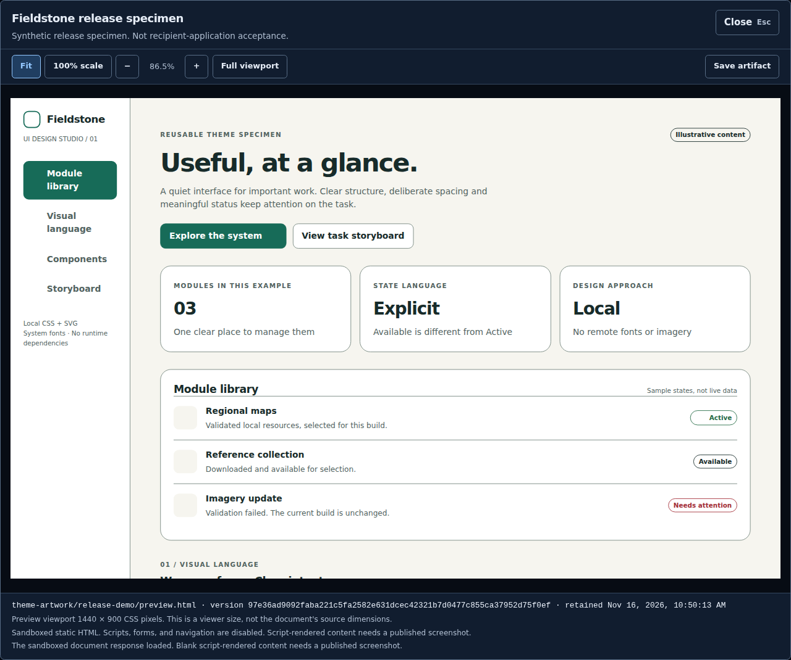

# UI Design Studio v1.4.2

Prepared 15 November 2026 UTC. This is a local release candidate, not a published release.

## Changes

This patch hardens the existing workflow. It adds no product feature, runtime dependency, or schema migration.

- Prevents bounded scopes from passing full-theme finalization and registration.
- Binds final acceptance to current assessment report bytes and retained artwork to its content-addressed identity.
- Preserves repository provenance, listener ownership, run selection, durable guided approvals, and polling recovery.
- Rejects blocking nonregular inputs, private environment files, and unchecked CSS image sources.
- Preserves explicit empty selections and corrects shared-file and transitive resume invalidation.
- Preflights release destinations and preserves existing archives if checksum publication fails.

The [changelog](CHANGELOG.md) lists the merged changes. The [feature-freeze records](feature-freeze/) retain the earlier audit evidence. The [validation record](VALIDATION.md) distinguishes current candidate checks from historical checks.

## Upgrade notes

An approval can become stale when its assessment report changes. Review the current evidence again rather than rewriting its expected digest. Incomplete legacy resume manifests require a reviewed refresh. Static CSS resource validation deliberately rejects unchecked dynamic image sources.

Real Chromium Back navigation resumes polling through a reload. It did not restore the page from BFCache. Authenticated responses retain their no-store policy.

## Screenshots

Fresh Chromium captures use synthetic projects and the 1.4.2 candidate. Private paths, connection identities, and bearer URLs are masked. These examples are not recipient-application acceptance evidence.

## Local artifacts

- `UI-Design-Studio-OMP-v1.4.2.zip` contains the source distribution, installer, changelog, release notes, and screenshots.
- `ui_design_studio_mcp-1.4.2-py3-none-any.whl` contains the standalone runtime, guides, and assets.
- `ui_design_studio_mcp-1.4.2.tar.gz` contains the Python source distribution.
- SHA-256 checksums verify exact bytes. They are not publisher signatures.

No tag, hosted release, or deployment is created by this build.

## Limits

Native Windows, native macOS, other browser engines, another physical LAN device, and human recipient-application testing remain unverified. Use loopback or protected transport on untrusted networks because LAN HTTP carries bearer credentials. The original checkout's uncommitted user changes are excluded from this candidate.
