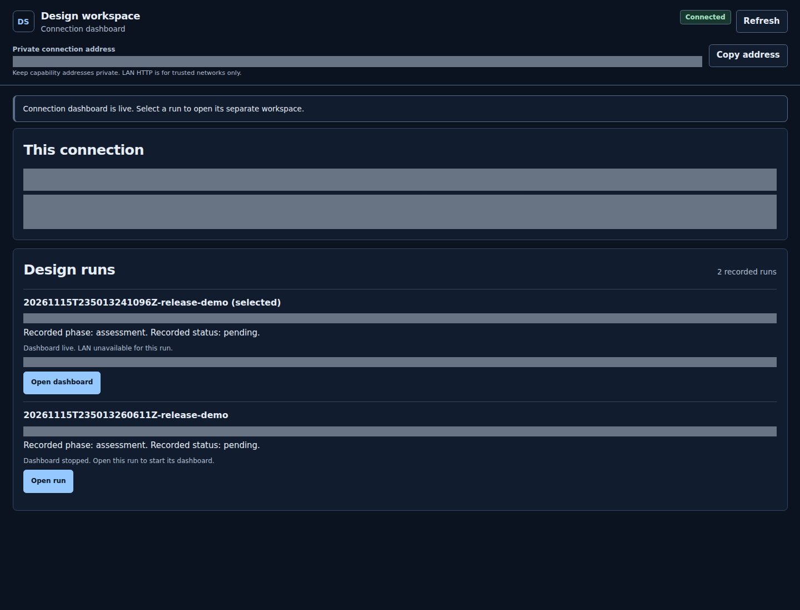
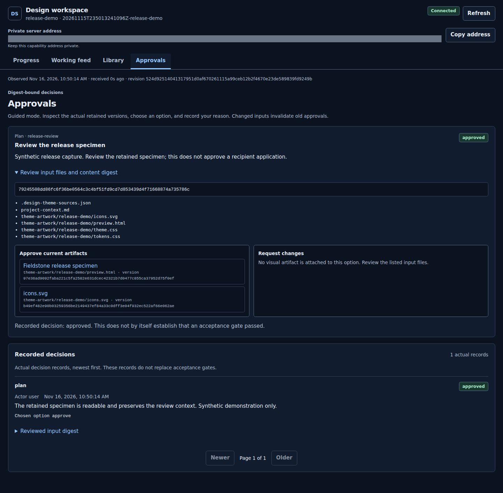
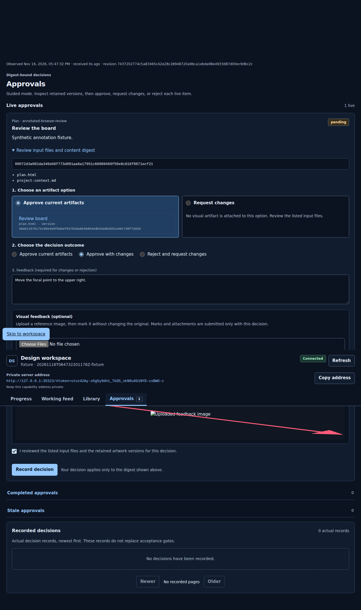
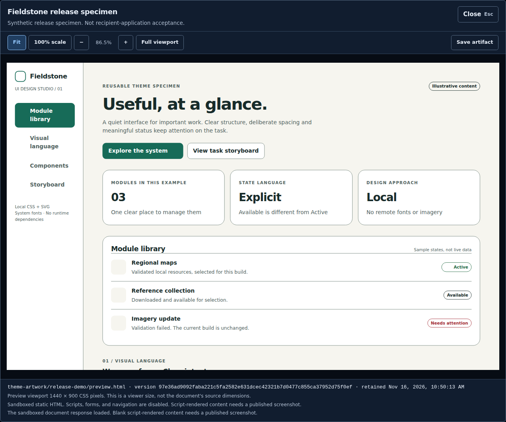

# UI Design Studio v1.4.3

Prepared 16 November 2026 UTC for the GitHub v1.4.3 release.

## Changes

This patch release publishes the initial repository documentation library and aligns package metadata with the documented release process. It adds no runtime dependency, run-schema migration, or application UI implementation.

- Added 16 source-grounded pages under `docs/documenter/` covering setup, configuration, architecture, workflows, reference, operations, security, testing, and troubleshooting.
- Recorded the Documenter inventory, file reviews, page reviews, coverage mappings, supported claims, and unresolved runtime/platform facts under `.documenter/`.
- Updated package, installer, MCP identity, and distribution metadata to 1.4.3.
- Preserved existing human-authored release, validation, feature-freeze, and remediation records.

## Screenshots

These redacted synthetic dashboard captures remain relevant visual references. They originate from v1.4.2 and are not new v1.4.3 recipient-application acceptance evidence.

## Verification scope

The release verification covers the focused package tests, the deterministic source archive, its checksum sidecar, and the GitHub release assets. Live OMP/provider execution, recipient-application testing, native platform checks, and other browser engines remain outside this patch release.

Checksums detect changed bytes. They are not publisher signatures.
